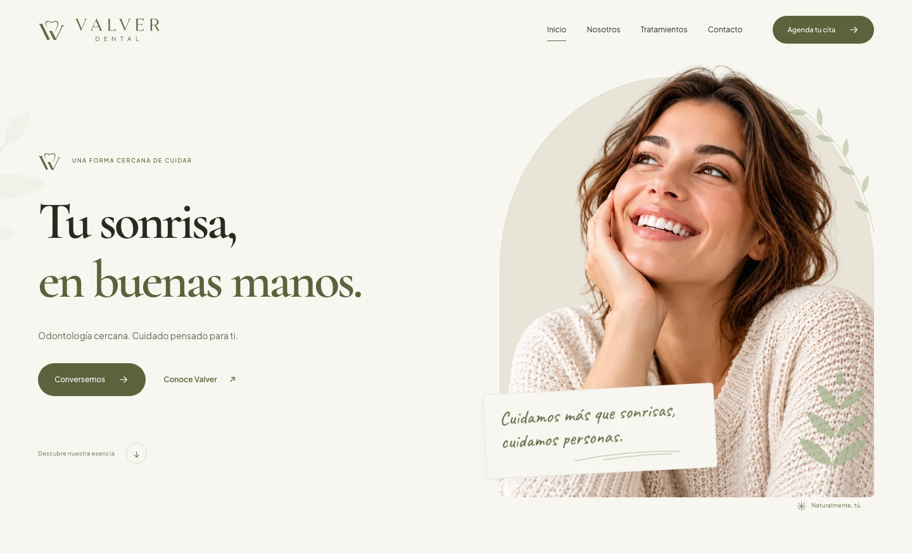
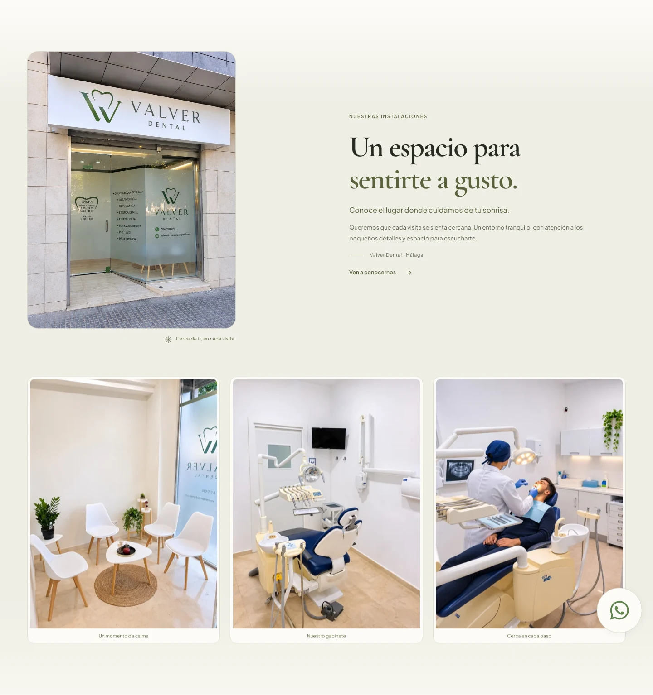
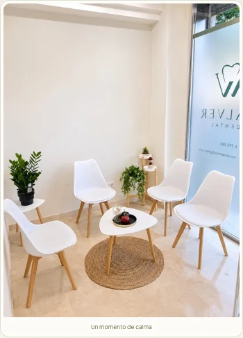

<p align="center"></p>

# Valver Dental — website

Website institucional em espanhol para a **Valver Dental**, em Málaga. Composição editorial em creme, verde oliva e sálvia, imagens locais, animações suaves e navegação responsiva.

**Versão do site: 4.11.0** · HTML semântico + ilhas React/TypeScript · Entrega estática com build incluído



## O que o site apresenta

| Seção | Conteúdo e comportamento |
| --- | --- |
| **Inicio** | Hero com retrato em moldura de janela, mensagem manuscrita e elementos botânicos. Parallax discreto no desktop. |
| **Nuestra esencia** | Filosofia de cuidado e fundo com fotografias ilustrativas em movimento. O texto permanece visível, sem etapas escondidas. |
| **Tratamientos** | Seis tratamentos em cards, com arrasto, setas, indicadores, autoplay com tempo de leitura e detalhes em diálogo. |
| **Nuestras instalaciones** | Foto da fachada à esquerda e texto à direita no desktop. Abaixo, galeria dos cinco interiores, com três fotos visíveis no desktop e uma no celular. |
| **La experiencia Valver** | Atendimento próximo, cuidado personalizado e conforto. |
| **Contacto** | WhatsApp, Instagram, e-mail, localização em Málaga e rodapé com ícones alinhados. |

A seção de avaliações fictícias foi removida. Os módulos anteriores permanecem arquivados no código e não são montados na página atual.

## Instalações da clínica

A fachada aparece em destaque acima da galeria, sem se repetir entre os slides. As fotografias dos interiores avançam uma por vez, com transição de **850 ms** e pausa de **4,5 segundos**. A página continua rolando livremente.



### Versão para celular

O texto precede a fachada e a galeria apresenta uma foto completa por vez. O botão de WhatsApp permanece fixo no canto inferior direito.

<p> </p>

## Executar localmente

### Pré-requisitos

- Git.
- Node.js **20.19** ou uma versão **a partir de 22.12**, conforme os requisitos do Vite instalado.
- npm.
- Python 3, caso prefira a prévia estática abaixo.

```sh
git clone https://github.com/valverdentalmalaga-code/site-valver.git
cd site-valver
npm ci
npm run dev
```

A prévia de desenvolvimento abre em **http://127.0.0.1:8791/**.

### Verificar e compilar

```sh
npm run typecheck
npm run build
```

O build atualiza `assets/runtime/hero-parallax.js` e `assets/runtime/hero-parallax.css`. Os demais arquivos HTML, CSS e JavaScript são servidos diretamente da raiz. **Não existe uma pasta `dist` com o site completo.**

### Abrir a entrega já compilada

```sh
python3 -m http.server 8790 --bind 127.0.0.1
```

Abra **http://127.0.0.1:8790/**. Os bundles já estão versionados, portanto essa prévia não exige recompilar antes de abrir.

## Stack e organização

| Camada | Tecnologia |
| --- | --- |
| Conteúdo | HTML semântico, CSS e JavaScript |
| Componentes interativos | React 19 e TypeScript |
| Build | Vite 8 |
| Design system | Tokens CSS e Tailwind CSS 4, com utilitários prefixados |
| Animações | GSAP, ScrollTrigger, Lenis e Motion |
| Medição da galeria | `react-use-measure` |
| Fontes locais | Cormorant Garamond, Plus Jakarta Sans e Caveat |

```text
site-valver/
├── index.html                 # Conteúdo e estrutura do site
├── config.js                  # Contatos públicos da clínica
├── site.css / site.js         # Layout, menu, diálogos e contatos
├── tokens.css                 # Cores, fontes e medidas compartilhadas
├── components.css             # Componentes do design system
├── design-system.html         # Guia visual
├── guide.css / guide.js       # Estilos e interações do guia
├── src/
│   ├── hero.tsx               # Montagem e desmontagem das ilhas React
│   └── hero.css               # Estilos dos componentes interativos
├── components/ui/             # Parallax, cards e galerias
├── demos/                     # Composição da hero
├── lib/                       # Utilitários compartilhados
├── assets/
│   ├── brand/                 # Identidade visual e ícones
│   ├── fonts/                 # Fontes e licenças
│   ├── photos/                # Imagens WebP e variantes móveis
│   ├── servicos/              # Artes dos tratamentos
│   └── runtime/               # JavaScript e CSS compilados
└── docs/                      # Publicação, branches e capturas do site
```

### Componentes principais

- `parallax-scrolling.tsx`: profundidade discreta na hero e ramo que acompanha o arco da moldura.
- `card-deck-carousel.tsx`: os seis tratamentos, navegação manual e reprodução automática com leitura.
- `great-ui-diagonal-marquee-carousel.tsx`: fundo fotográfico da seção de essência.
- `infinite-slider-horizontal.tsx`: medição do período, repetição e avanço suave da faixa.
- `facilities-gallery.tsx`: cinco fotografias dos interiores, legendas em espanhol e composição da galeria.

## Tratamentos

1. Odontología general.
2. Ortodoncia.
3. Estética dental.
4. Periodoncia.
5. Cirugía integral.
6. Prostodoncia.

O visitante pode avançar pelos cards e continuar para as outras seções sem precisar percorrer todos os tratamentos com o scroll.

## Contatos e configuração

| Canal | Destino |
| --- | --- |
| WhatsApp | [+34 604 970 085](https://wa.me/34604970085) |
| Instagram | [@valverdental_](https://www.instagram.com/valverdental_/) |
| E-mail | [valverdentalmalaga@gmail.com](mailto:valverdentalmalaga@gmail.com) |
| Endereço | Calle Omar, 14, 29004 Málaga |

Os dados foram fornecidos pelo responsável pelo projeto. A janela de contato segue a ordem **WhatsApp → Instagram → e-mail**. O WhatsApp usa mensagem inicial em espanhol; o telefone do bloco de localização é apresentado como texto.

Edite `config.js` para atualizar os canais públicos. Confira também os links e informações explícitas no HTML. `bookingUrl` permanece vazio; o site não simula reserva, envio de formulário nem confirmação de agendamento.

## Responsividade e acessibilidade

- Layout adaptado a desktop, tablet e celular.
- Menu móvel com teclado, estados acessíveis e fechamento com Escape.
- Diálogos nativos, foco visível e restauração de foco.
- Textos alternativos para as fotografias e nomes acessíveis nos ícones sem texto visível.
- Cópias decorativas das imagens fora da leitura assistiva.
- Respeito a `prefers-reduced-motion`; a galeria fica estática com rolagem horizontal nativa.
- Movimento da galeria suspenso fora da viewport ou com a aba oculta.
- Passar o mouse não pausa as fotos.
- Conteúdo, fachada e faixa de interiores preservados em HTML quando JavaScript está desativado.

## Fotos, identidade e licenças

A fotografia da fachada e as cinco fotografias dos interiores foram fornecidas para o projeto na pasta `Imagens-Valver`. As imagens ilustrativas usadas em outras partes do site têm origem documentada em [assets/ASSETS.md](assets/ASSETS.md) e não devem ser tratadas como retratos de pacientes, equipe ou instalações reais.

As licenças das fontes acompanham os arquivos em `assets/fonts/`. O logotipo e demais materiais da marca foram fornecidos para este projeto. **Não há uma licença geral concedendo uso irrestrito da marca e de todas as imagens.**

As capturas deste README mostram o estado atual do site. Os módulos e assets de avaliações arquivados não aparecem na página.

## Publicação

Publique a **raiz do repositório**, com `index.html`, arquivos CSS/JS, `config.js` e `assets/`. Se o provedor exigir um build, use:

```sh
npm ci && npm run build
```

O build compila as ilhas React; `assets/runtime` sozinho não é o site completo. O envio dos commits ao GitHub não configura automaticamente domínio ou hospedagem.

Veja o passo a passo e a verificação funcional em [docs/PUBLISHING.md](docs/PUBLISHING.md).

## Branches e commits

Esta entrega foi organizada em **dez branches temáticas com três commits próprios cada**, totalizando **30 novos commits de importação**. As branches são sequenciais; a `main` contém a versão completa. O histórico e o README inicial do repositório de destino foram preservados.

Cada commit descreve os arquivos incluídos e seu propósito. A importação registra o site já existente, sem commits vazios nem datas retroativas. Consulte a tabela em [docs/BRANCHES.md](docs/BRANCHES.md).

## Validação da entrega

Build e tipagem verificados, com revisão em Chromium nas larguras 320, 390, 768 e 1440 px. A conferência inclui o número de fotos visíveis, a ordem da fachada e do texto, a ausência de overflow, contatos, movimento reduzido e carregamento das imagens.

## Indexação e busca local

O site inclui `robots.txt`, `sitemap.xml` com imagens, canonical HTTPS e dados estruturados de clínica odontológica em Málaga. O guia visual fica fora da indexação. Para vincular o sitemap ao Search Console e manter os metadados, consulte [docs/SEO.md](docs/SEO.md).
